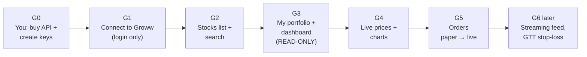

# Groww Integration Plan (replacing Angel One)

> | | |
> |---|---|
> | **Status** | **G1–G3 built** (uncommitted) with the recommended decisions D1–D4. Waiting for your keys in `.env` to test against real Groww. G4 is partly done (LTP feed, quotes, candles). |
> | **Written** | 2026-11-24 |
> | **Based on** | Groww Trade API docs, read 2026-11-24 ([REST docs](https://groww.in/trade-api/docs/curl), [Python SDK docs](https://groww.in/trade-api/docs/python-sdk)) |
> | **Related** | [PROJECT_FLOW.md](PROJECT_FLOW.md) — update it as each phase lands |

---

## 1. The idea in plain words

Angel One is being removed and Groww takes its place. At the same time, the work order changes: **basics first** (your real portfolio, a personal dashboard, a stock list with search). Analysis, the AI and alerts come after that.

The safe order to switch on your real account:



**Rule:** until G5, the app only **reads** from Groww. No order can reach Groww until G5, and only after the safety fixes listed there.

---

## 2. What Groww gives us (summary of the docs)

All REST calls go to `https://api.groww.in/v1/...` with these headers:

```
Authorization: Bearer <ACCESS_TOKEN>
Accept: application/json
X-API-VERSION: 1.0
```

Every response is wrapped:
- success: `{"status":"SUCCESS","payload":{...}}`
- failure: `{"status":"FAILURE","error":{"code":"GA00x","message":...}}`

| Need | Groww endpoint | Notes |
|---|---|---|
| **Login → token** | `POST /v1/token/api/access` | 3 ways, see §4. **The token dies every day at 6:00 AM.** |
| **Stock list** | CSV at `https://growwapi-assets.groww.in/instruments/instrument.csv` | Columns include `exchange`, `exchange_token`, `trading_symbol`, `groww_symbol`, `name`, `instrument_type`, `segment`, `isin`, `lot_size`, `tick_size`. NSE equity = `exchange=NSE, segment=CASH, instrument_type=EQ`. |
| **Your profile** | `GET /v1/user/detail` | `ucc`, `nse_enabled`, `bse_enabled`, `active_segments` |
| **Funds / margin** | `GET /v1/margins/detail/user` | `clear_cash`, `net_margin_used`, `equity_margin_details.cnc_balance_available`, … |
| **Holdings** | `GET /v1/holdings/user` | `trading_symbol`, `isin`, `quantity`, `average_price`, `t1_quantity`, … (**no live price or P&L** — we add those) |
| **Positions (today)** | `GET /v1/positions/user?segment=CASH` | `trading_symbol`, `quantity`, `net_price`, `realised_pnl`, … |
| **Last price, many stocks** | `GET /v1/live-data/ltp?segment=CASH&exchange_symbols=NSE_RELIANCE,NSE_TCS` | **Up to 50 per call.** Reply: `{"NSE_RELIANCE": 2334.2, ...}` |
| **Full quote, one stock** | `GET /v1/live-data/quote?exchange=NSE&segment=CASH&trading_symbol=RELIANCE` | `last_price`, `day_change`, `day_change_perc`, `volume`, `week_52_high/low`, `market_cap`, `depth`. ⚠ `ohlc` comes back as a **string**, not an object. |
| **Candles (history)** | `GET /v1/historical/candles?exchange=NSE&segment=CASH&groww_symbol=NSE-RELIANCE&start_time=...&end_time=...&candle_interval=1day` | Intervals `1minute … 1day, 1week, 1month`. **Max 180 days per call** for daily (30 days for 1–5 min). Each row: `[timestamp-string, open, high, low, close, volume, oi]`. The old `/historical/candle/range` endpoint is deprecated — don't use it. |
| **Place order** | `POST /v1/order/create` | `trading_symbol, quantity, price, trigger_price, validity=DAY, exchange=NSE, segment=CASH, product=CNC, order_type=MARKET\|LIMIT\|SL\|SL_M, transaction_type=BUY\|SELL, order_reference_id` (8–20 chars, our idempotency key) |
| **Modify / cancel** | `POST /v1/order/modify`, `POST /v1/order/cancel` | by `groww_order_id` |
| **Order status** | `GET /v1/order/status/{groww_order_id}?segment=CASH` | `order_status`, `filled_quantity`, `remark` |
| **Order book (today)** | `GET /v1/order/list?segment=CASH&page=0&page_size=100` | |
| **Live streaming** | Python SDK only (`GrowwFeed`, NATS over WebSocket + protobuf) | No documented raw protocol, so Java can't use it directly. Up to 1000 subscriptions. |
| **Stop-loss/target (GTT/OCO)** | `/v1/order-advance/*` | Later (G6). |
| **Fundamentals (P/E, ROE, EPS, FII/DII)** | ❌ **Not provided by Groww** | Keep Yahoo. The quote does give `market_cap` and 52-week high/low. |

**Rate limits**

| Category | Limit |
|---|---|
| Orders | 10/s, 250/min |
| Live data | 10/s, 300/min |
| Status, holdings, positions, margin | 20/s, 500/min |
| Token endpoint | 5/s, 30/min, **150/day** |
| Candles, instruments, user profile | Not documented — be gentle |

**Not supported:** MCX (commodities). The docs don't mention a static-IP requirement.

---

## 3. Angel One → Groww: what maps to what

| Concept | Angel One (today) | Groww (new) |
|---|---|---|
| Login | client code + password + TOTP → `jwtToken` | access token (manual, or API key + secret/TOTP) → `token`. Expires 6 AM daily. |
| Stock ID | numeric `symboltoken` (e.g. `2885`) | `trading_symbol` (`RELIANCE`) + `exchange`; `exchange_token` (`2885`) is used by the feed; `groww_symbol` (`NSE-RELIANCE`) is used by candles |
| Last price | `getLtpData`, 1 stock per call | `live-data/ltp`, **50 stocks per call** |
| Candles | `getCandleData`, ONE_DAY/FIVE_MINUTE… | `historical/candles`, `1day`/`5minute`…, string timestamps |
| Product | `DELIVERY` | `CNC` (intraday = `MIS`) |
| Order types | MARKET, LIMIT | MARKET, LIMIT, SL, SL_M |
| Order id | `orderid` | `groww_order_id` + our `order_reference_id` |
| Order status | (never polled) | NEW, ACKED, TRIGGER_PENDING, APPROVED, EXECUTED, COMPLETED, DELIVERY_AWAITED, REJECTED, FAILED, CANCELLED, … |
| Holdings | not used | `holdings/user` |
| Funds | not used | `margins/detail/user` |
| Odd headers | X-PrivateKey, X-MACAddress, X-ClientLocalIP… | none — just Bearer + `X-API-VERSION: 1.0` |

### How we identify a stock inside our app

Today the whole app (DB rows, URLs, WebSocket, frontend) uses `token` like `2885`.

Groww's CSV has `exchange_token`, which for NSE is the same NSE number (Groww's own feed example uses `"2885"` for RELIANCE). So:

> **Keep `token` = the NSE `exchange_token`** and add `trading_symbol`, `groww_symbol`, `isin` and `lot_size` columns to the `instrument` table.
> Nothing else in the app has to change its keys, and the 10 seeded stocks keep working.
> Trade-off: NSE only for now. BSE would collide (BSE uses different numbers), so adding BSE later needs a combined key (decision D1).

---

## 4. Login: the daily token problem

The token expires every day at 6:00 AM. Groww's docs list three ways to get one:

| Way | What you do | What the app does | Daily effort |
|---|---|---|---|
| **A. Manual token** | Copy the access token from Groww app → Trading APIs → paste into `.env` | Uses it as-is | Paste a new token every morning |
| **B. API key + secret** | Approve the key once a day on the Groww API-keys page | App computes `checksum = sha256(secret + timestamp)` and calls `/token/api/access` with `key_type=approval` | One tap in Groww each morning |
| **C. API key + TOTP** | Same daily approval; also save the TOTP secret | App generates the 6-digit TOTP (library already in `pom.xml`) and calls `/token/api/access` with `key_type=totp` | One tap each morning |

The docs say both key-based ways need a daily approval. We'll confirm the exact behaviour once you have keys.

**Plan:** support **A** (simplest, best for first tests) and **B**, chosen by `GROWW_AUTH_MODE`. The app:
- refreshes the token by itself at about 6:05 AM IST and whenever Groww returns an auth error (GA005), capped well under 150 calls/day;
- shows "Groww: connected / token expired — approve in Groww" on the dashboard, so you know when to act.

---

## 5. Code changes, file by file

### 5.1 Java api — `apps/api`

| File | Change |
|---|---|
| `broker/AngelOneAdapter.java` → **`broker/BrokerAdapter.java`** | Broker-neutral interface: `login()`, `getProfile()`, `getFunds()`, `getHoldings()`, `getPositions()`, `getLtp(List<Instrument>)`, `getQuote(Instrument)`, `getCandles(...)`, `placeOrder(...)`, `getOrderStatus(...)`, `cancelOrder(...)` |
| `broker/AngelOneClient.java` → **delete**, new **`broker/groww/GrowwClient.java`** | All Groww REST calls. One helper unwraps the `SUCCESS/FAILURE` envelope and turns `GA00x` codes into clean errors. Parses the string-typed `ohlc`. |
| new `broker/groww/GrowwAuth.java` | Token modes A/B (and C), the checksum maths, expiry = next 6:00 AM IST |
| new `broker/groww/GrowwRateLimiter.java` | Simple token buckets per category (orders 10/s, live 10/s, non-trading 20/s) |
| new `broker/groww/GrowwDtos.java` | Records for Groww JSON (holding, position, margin, quote, order, candle row) |
| `broker/AngelOneSession.java` → **`BrokerSession.java`** | `accessToken` + `expiresAt` |
| `broker/BrokerSessionProvider.java` | Refresh on expiry (6 AM IST) or auth error, instead of a fixed 6 hours |
| `broker/BrokerController.java` | `GET /api/broker/status` → Groww profile + token state (connected / expires at / needs approval) |
| `marketdata/AngelOneMarketFeed.java` → **`GrowwMarketFeed.java`** | Polls `ltp` in **batches of 50**, every 2 s, **only in market hours** (Mon–Fri 9:15–15:30 IST). Feeds the same `QuoteCache.publish()`, so WebSocket and UI are unchanged. |
| `marketdata/CandleService.java` | Use Groww candles; split long ranges into ≤180-day chunks; map intervals (`1d`→`1day`, `5m`→`5minute`…); parse string timestamps as IST. **Also fix B9:** fetch only the missing recent days instead of never refreshing. |
| `instrument/Instrument.java` | Add `tradingSymbol`, `growwSymbol`, `isin`, `lotSize`, `tickSize` |
| `instrument/SymbolMasterSeeder.java` → **`InstrumentSync.java`** | Download the Groww CSV at startup + daily, upsert all **NSE CASH EQ** rows (about 2,000+). Mock mode keeps the 10-stock seed. **Also fixes B7** (startup order). |
| `instrument/InstrumentController.java` | Search on symbol + name over the full list (already works; just more rows) |
| new **`portfolio/BrokerPortfolioService.java`** | Real holdings + positions + funds from Groww, plus live prices (one `ltp` call) → P&L, day change, allocation |
| `position/PortfolioController.java` | Live mode: Groww holdings. Paper mode: today's app-side positions (decision D2). |
| `order/LiveTradeExecutor.java` | `POST /order/create` with `product=CNC`, `validity=DAY` and `order_reference_id` = derived from our order UUID (duplicate submits are rejected by Groww with GA007). |
| new `order/OrderStatusPoller.java` | Every 5 s, checks SUBMITTED/OPEN orders; maps Groww status → ours; on fill, updates position + realised P&L. **Fixes B12.** |
| `order/OrderEnums.java` | Add `SL`, `SL_M` types (used later); keep our own status enum, mapped from Groww's |
| `config/AppProperties.java`, `application.yml` | Remove `angelone.*`; add `groww.*` (base URL, auth mode, key/secret/token) |

**Groww → our order status mapping**

| Groww `order_status` | Our status |
|---|---|
| NEW, ACKED, APPROVED, TRIGGER_PENDING, MODIFICATION_REQUESTED | OPEN |
| EXECUTED, COMPLETED, DELIVERY_AWAITED (and `filled_quantity == quantity`) | FILLED |
| any of the above with `0 < filled_quantity < quantity` | OPEN (show filled qty) |
| REJECTED, FAILED | REJECTED |
| CANCELLED, CANCELLATION_REQUESTED | CANCELLED |

### 5.2 Python analysis — `apps/analysis`

- **Fundamentals:** no change. Groww has none, so Yahoo stays. Fix B11 (D/E is a percentage) while we're there.
- **MCP server:** no change needed; it calls our api, not the broker. Later it gains `get_holdings`, `get_funds` and `search_instruments` tools for free.
- **G6 (optional, later):** a small `feed_bridge.py` using the official `growwapi` SDK `GrowwFeed` to stream real ticks into Redis `chan:ticks`. This is the only way to get true streaming, because the feed protocol is Python-SDK-only.

### 5.3 Web — `apps/web` (the "basics" screens)

| Screen | Data |
|---|---|
| **Dashboard (new home)** | Groww connection status · funds available · total invested / current value / total P&L / today's P&L · top movers in my holdings · my watchlist with live prices |
| **Portfolio** | Real holdings table (qty, avg, LTP, P&L, day change, allocation), positions tab, concentration view (already built) |
| **Stocks** | Search the full NSE list → stock page: quote (price, day change, 52-week range, volume, market cap) + chart |
| **Orders** | Existing ticket. Gains: shows broker status/filled qty, a real order-book tab, and a clear "PAPER / LIVE" badge from the api (fixes B18 part) |
| Header | Show real mode + Groww status instead of the hard-coded "Paper trading" |

### 5.4 Config, infra and docs

- `.env.example`, `docker-compose.yml`, `render.yaml`: remove `ANGEL_ONE_*`; add `GROWW_AUTH_MODE`, `GROWW_ACCESS_TOKEN`, `GROWW_API_KEY`, `GROWW_API_SECRET`.
- `README.md`, `PROJECT_FLOW.md`: switch every Angel One mention to Groww; update flows 5.1, 5.2, 5.8, 5.9, 5.11.

---

## 6. Phases, with "done when" checks

| Phase | What | Done when |
|---|---|---|
| **G0 — You** | Buy the Groww Trading API subscription (Groww app → Profile → Trading APIs; price shown there). Generate an API key + secret, and/or an access token. **Put them in `.env` yourself** — don't paste secrets in chat. | Keys exist in your local `.env` |
| **G1 — Connect** ✅ built | `BrokerAdapter`, `GrowwClient` (envelope, errors, rate limiter), `GrowwAuth`, config; delete Angel One classes | Unit tests pass against sample JSON from the docs. With your keys: `GET /api/broker/status` shows your UCC and "connected". |
| **G2 — Stocks** ✅ built | `InstrumentSync` from the CSV, extra instrument columns, search UI, user watchlist (table + UI) | Search "tata" lists Tata stocks; adding one to the watchlist persists |
| **G3 — Portfolio & dashboard (read-only)** ✅ built | Holdings, positions, funds, profile → Portfolio page + new Dashboard | Numbers match what the Groww app shows for your account |
| **G4 — Prices & charts** 🟡 code done, untested live | `GrowwMarketFeed` (batched LTP), quote endpoint, Groww candles + B9 fix | Watchlist/holdings prices move during market hours; chart shows real daily candles |
| **G5 — Orders** | `LiveTradeExecutor` on Groww, `OrderStatusPoller`, order book. **Before enabling live:** fix B6 (auth on orders/portfolio), B13 (re-check risk + draft expiry), B14 (₹0 market orders), B15 (SELL holdings check). | Paper flow unchanged; then **one 1-share live order with you watching**, which shows FILLED and appears in holdings |
| **G6 — Later** | Python streaming bridge, GTT/OCO stop-loss orders, BSE support | — |

**Testing approach**
1. Unit tests in Java use canned JSON copied from the Groww doc samples (`MockRestServiceServer`), so G1–G4 can be built and tested before you buy anything.
2. Read-only smoke tests against your real account (profile, funds, holdings, LTP, candles).
3. Paper trading against real prices.
4. One tiny live order.

---

## 7. Safety notes (real account = real data)

- **Don't deploy to Render with a real Groww token until login is added (B6).** Today `/api/portfolio` is public, so anyone with the URL would see your real holdings. Run locally until then.
- Keep `TRADING_MODE=paper` through G1–G4. Live data + paper trades is the target setup for daily use until G5 is done.
- Secrets live only in `.env` (already git-ignored, and confirmed not tracked). Never commit or paste them.
- `order_reference_id` gives idempotency: a double-click or retry can't create two real orders.
- The AI/MCP can still only create **drafts**; confirm stays human-only.

---

## 8. What gets deleted

- `AngelOneAdapter.java`, `AngelOneClient.java`, `AngelOneSession.java`, `AngelOneMarketFeed.java`
- `easetrading.angelone.*` config and `ANGEL_ONE_*` env vars
- Angel One wording in README, code comments and `PROJECT_FLOW.md`

The broker-credential table (`broker_credentials`) stays for later multi-user use. Its columns will be renamed for Groww in a later step, because v1 reads keys from `.env`.

---

## 9. Decisions needed from you

| # | Question | My recommendation |
|---|---|---|
| D1 | NSE only for now, or BSE too? | **NSE only.** Keeps the `token` key unchanged; add BSE later. |
| D2 | In live mode, Portfolio shows real Groww holdings. Where do paper-trade holdings go? | **Show Groww holdings as "My Portfolio"** and paper positions in a separate "Paper" tab. |
| D3 | Login method | Start with **A (manual token)** for first tests, then **B (key + secret)** for daily use. |
| D4 | Order of work | **G1 → G2 → G3 now** (buildable before you buy). Plug in your keys at G3, then G4, then G5. |

---

## 10. To verify on the first real run

- [x] Login works with `GROWW_AUTH_MODE=approval` (API key + secret). ✅ 2026-11-24
- [x] Instrument CSV downloads: 4,334 NSE equities saved. ✅
- [x] Profile, funds, holdings and positions load. ✅
- [ ] ⛔ **Free plan:** `/live-data/ltp`, `/live-data/ohlc`, `/live-data/quote` and `/historical/candles` all return **403 "Access forbidden for this request"**. The items below need the paid plan (or another price source).
- [ ] `/v1/live-data/ltp` keys come back as `NSE_<trading_symbol>`.
- [ ] OHLC `close` = previous day's close (used for today's P&L).
- [ ] Candle timestamps are IST (chart dates line up with the Groww app).
- [ ] Holdings, funds and P&L match the Groww app.

## Sources

- Groww Trade API REST docs: [intro/auth/rate limits](https://groww.in/trade-api/docs/curl), [instruments](https://groww.in/trade-api/docs/curl/instruments), [orders](https://groww.in/trade-api/docs/curl/orders), [portfolio](https://groww.in/trade-api/docs/curl/portfolio), [margin](https://groww.in/trade-api/docs/curl/margin), [live data](https://groww.in/trade-api/docs/curl/live-data), [historical (deprecated)](https://groww.in/trade-api/docs/curl/historical-data), [backtesting / candles](https://groww.in/trade-api/docs/curl/backtesting), [user](https://groww.in/trade-api/docs/curl/user), [annexures / enums](https://groww.in/trade-api/docs/curl/annexures), [smart orders](https://groww.in/trade-api/docs/curl/smart-orders)
- Python SDK: [overview](https://groww.in/trade-api/docs/python-sdk), [feed](https://groww.in/trade-api/docs/python-sdk/feed), [changelog](https://groww.in/trade-api/docs/python-sdk/changelog)
- Groww blog: [API trading on Groww](https://groww.in/blog/api-trading-on-groww)

**Known doc inconsistencies to code around**
- `order_reference_id` is "required" in the REST schema but "optional" in the SDK → always send it.
- The token endpoint's auth header is described both with and without "Bearer" → try "Bearer" first, as in the sample.
- `ohlc` values are strings → parse them.
- The candle timestamp has no timezone → assume IST and verify on the first real call.
