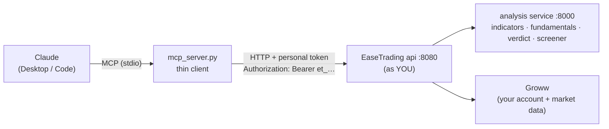

# Connect EaseTrading to Claude (MCP) — Plan

> | | |
> |---|---|
> | **Status** | Review done 2026-11-28. Not started. |
> | **Goal** | In Claude (Desktop, Code, later claude.ai) you ask *"Analyse RELIANCE"* or *"How is my portfolio doing?"* and Claude answers using live EaseTrading data — your own account, through your own login. |
> | **Related** | [PROJECT_FLOW.md](PROJECT_FLOW.md) §5.6–5.7, [MULTI_USER_PLAN.md](MULTI_USER_PLAN.md) |

---

## 1. How it should work

- **Claude does the thinking.** The MCP tools only fetch exact numbers (prices, indicators, fundamentals, your holdings), so answers are grounded, not guessed.
- **Every tool call is made as you**, using a personal token you create in Settings → you only ever see your own portfolio/watchlist.
- **No order tools.** Claude can read, never trade.

---

## 2. What the review found (2026-11-28)

### Blockers — nothing works until these are fixed

| # | Problem | Evidence |
|---|---|---|
| X1 | **The Python analysis service isn't running and can't be installed as-is.** The Mac's Python is 3.9 (too old for the `mcp` package, which needs ≥ 3.10); Homebrew's Python is 3.14 (too new for the pinned pandas 2.2.2 / numpy 1.26.4). No packages installed. | `/api/analysis/2885` and `/api/indicators/2885` → **500** "I/O error … localhost:8000". So indicators, fundamentals, AI verdict and screener are all down today. |
| X2 | **The MCP server can't log in.** Since login was added, every api call needs a logged-in user; the MCP server sends nothing → every tool gets **401**. | `SecurityConfig`: only `/api/auth/**` and `/api/health` are open. |
| X3 | **Not registered in any Claude app.** Claude Desktop has only kubernetes/elastic/prometheus servers configured; Claude Code has none for EaseTrading. Its default address `http://api:8080` only works inside Docker. | `claude_desktop_config.json`, `mcp_server.py:35` |

### Gaps in the tools

| # | Gap |
|---|---|
| T1 | `run_screener` builds its stock list from `/api/instruments/search?q=` → returns `[]` → screens **0 stocks** (B3). Should call `POST /api/screener/run`. |
| T2 | No way to turn "RELIANCE" into its token `2885`, yet most tools need the token (B4) → add `search_stocks`. |
| T3 | `get_fundamentals` / `get_indicators` compute inside the MCP process with its own settings, skipping the api (and your login). Should call the api. |
| T4 | Missing tools: **analyse a stock** (the platform's grounded verdict + 10 personas), **funds**, **watchlist**, **alerts**, **stock quote** (day change, 52-week). |
| T5 | Errors come back as raw JSON (`{"status":401…}`) → Claude can't tell you what to do. Should be one plain sentence ("Groww not connected — approve your key, then Reconnect in Settings"). |
| T6 | `strategies/claude_runner.py` (the api calling Claude itself via the Agent SDK) can never succeed (B1, B2) and doesn't fit a multi-user server anyway. With MCP, Claude in your own app does the thinking → **remove it**; the web "Analyze" button keeps the deterministic grounded verdict. |

---

## 3. Steps

| Step | What | Done when |
|---|---|---|
| **M1 — Python env** | Install `uv`; create a Python **3.12** environment for `apps/analysis` (pinned versions have 3.12 wheels); run the analysis service on :8000 in its own terminal tab; run its 22 tests. | `/api/indicators/2885` and `/api/analysis/2885` return data in the web app. |
| **M2 — Personal token for Claude** | Settings → **Connect Claude** → *Create token*: shown **once**, stored **hashed**, **read-only**, revocable, shows last-used time. The api accepts `Authorization: Bearer et_…` and maps it to your user. New table `api_token`. | A token can read your portfolio; a revoked token gets 401; it can't change anything. |
| **M3 — Rewrite `mcp_server.py` as a thin api client** | Reads `EASETRADING_API_URL` + `EASETRADING_TOKEN`. Tools: `search_stocks`, `get_quote`, `get_price_history`, `get_indicators`, `get_fundamentals`, `analyze_stock(strategy)`, `list_strategies`, `run_screener`, `get_portfolio`, `get_funds`, `get_watchlist`, `get_alerts`. Plain-English errors. No order tools. | Each tool returns real data against the local api. |
| **M4 — Register with Claude** | Claude Code: `claude mcp add easetrading …`. Claude Desktop: add an `easetrading` entry to its config. Short setup guide in the README. | In Claude: *"Analyse RELIANCE with the Citadel strategy"* returns numbers that match the web app. |
| **M5 — Simplify** | Remove `claude_runner.py`, `requirements-ai.txt`'s Agent SDK, and the Claude branch in `strategies/service.py`. | Web "Analyze" still works (grounded verdict); tests pass. |
| **M6 — Later, after deploying** | Remote MCP endpoint on the domain (`https://<domain>/mcp`, Streamable HTTP) with OAuth, so any user can add EaseTrading as a **custom connector** in claude.ai / Desktop without installing anything. | A second user connects their own Claude to their own account. |

Order: **M1 → M2 → M3 → M4 → M5** now (all local); M6 after the domain + server.

---

## 4. Decisions

1. Remove the server-side Claude runner (T6)? — *recommended: yes.*
2. Tools read-only, or may Claude also **add to watchlist / create alerts**? — *recommended: read-only first.*
3. Which Claude app first — Desktop, Code, or both? — *recommended: both (same server, two short configs).*
