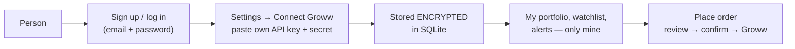

# Multi-user EaseTrading — Plan

> | | |
> |---|---|
> | **Status** | **P1 + P4 + P2 done** (2026-11-26): login (email/password + Google), every endpoint needs login, each user links their own Groww account (encrypted). Next: **P3 — real orders**. |
> | **Goal** | Anyone can sign up, connect **their own** Groww account, see their portfolio, and **place real orders** — each user sees only their own data. |
> | **Related** | [PROJECT_FLOW.md](PROJECT_FLOW.md) (update it as each phase lands), [GROWW_INTEGRATION_PLAN.md](GROWW_INTEGRATION_PLAN.md) |

---

## 1. The idea in plain words

- **No Groww PIN, ever.** Groww offers no "Sign in with Groww"; the PIN only unlocks Groww's own app. Each user uses their own **Trading API key + secret** (and their own Groww API subscription).
- **The server never shows a key again** once saved — it is encrypted at rest and only decrypted in memory to log in to Groww.
- **Every order needs a human click** on a review screen. AI/MCP can never place orders.

---

## 2. Phases

| Phase | What | Done when |
|---|---|---|
| **P1 — Login** | Register / login / logout pages. Passwords hashed (BCrypt — exists). Login token in an **httpOnly cookie**. **Every endpoint requires login** (fixes B6). Remove the "dev user". Slow down repeated failed logins. | A logged-out browser gets nothing; two test accounts can't see each other's watchlist/alerts. |
| **P2 — Connect Groww (per user)** | New table `broker_account` (user, encrypted key, encrypted secret, status, last error). AES-GCM encryption key in server env (`CREDENTIAL_AES_KEY`). Settings page: paste key + secret, Reconnect, Disconnect. Per-user Groww session (one login attempt, then wait for Reconnect — no retries). Holdings, funds, positions per user. | Two users each see their own Groww holdings/funds. Keys in the DB file are unreadable without the server key. |
| **P3 — Real orders** | Order ticket on the stock page → **review screen** (risk checks) → **Confirm** → Groww `/v1/order/create` with an idempotency id → status sync → **Order book** page with cancel. Safety: per-user max order value, risk re-checked at confirm, draft expires in 2 min, no ₹0 market orders, SELL only what you hold, every step in the audit log. | A 1-share order placed by you shows FILLED in the app and in Groww. Double-clicking Confirm can't create two orders. |
| **P4 — Google sign-in** *(optional)* | "Continue with Google" on the login page, same `users` table. Needs a Google OAuth client (you create it in Google Cloud Console). | Google login lands in the same account as email login with the same address. |
| **P5 — Go online** | Buy the domain. Small VPS with a **static IP** and permanent disk. Caddy for free HTTPS. Daily SQLite backup. Secrets only in the server's env. | `https://yourdomain` works from any phone/laptop; restart keeps all data. |
| **P6 — Before inviting others** | Check Groww's API terms and SEBI's 2025 retail-API rules (static IP per key; platforms serving other people may need exchange empanelment via a broker). Privacy note + terms page. Invite-only to start. | Written OK from yourself after reading the current rules. |

**Order of work:** P1 → P2 → P3 on your Mac (safe to test), then P5 to put it online, P6 before inviting anyone. P4 whenever you want it.

---

## 3. Database (SQLite) after P1–P3

| Table | Holds | Status |
|---|---|---|
| `users` | email, password hash, role | exists |
| `broker_account` | user → encrypted Groww key + secret, status, last error | **new (P2)** |
| `watchlist_item` | user's watchlist | exists (user-scoped) |
| `alert` | user's alerts | exists (user-scoped) |
| `orders` | user's real orders: draft → confirmed → Groww order id → status | table exists; code re-added in P3 |
| `analysis_report` | AI analysis history | exists (add user link) |
| `audit_log` | every login, key change, order step | exists |

Prices, the stock list and candles stay in memory (shared by everyone).

---

## 4. Things each user must do on Groww

1. Buy Groww's **Trading API** subscription (market data needs the paid plan).
2. Create an API key + secret and **whitelist the server's static IP** on that key (from P5).
3. **Approve the key each day** on Groww's API-keys page, then press Reconnect in the app.

---

## 5. Decisions still open

- Per-user maximum order value default (suggest ₹10,000 to start).
- Domain name.
