# EaseTrading — Project Flow Report

> **Living document.** Every code change updates this file in the same commit:
> the affected flow, the Status Board, the Issues list, and a Changelog row.
>
> | | |
> |---|---|
> | **Last updated** | 2026-11-24 (Groww G1–G3) |
> | **Code version** | uncommitted changes on top of `1f8d7f1` (main) |
> | **Reviewed by** | Full line-by-line read of `apps/analysis`, `apps/api`, `apps/web`, `infra`, `render.yaml` |
> | **Tests run?** | ✅ Java: 27/27 pass (`mvn test`). ✅ Web: `tsc` + `next build` pass. ✅ Mock mode checked end-to-end in the browser. ❌ Python tests not run (no pandas on this Mac). ✅ First real Groww run 2026-11-24: login, profile, funds, holdings, positions, stock list OK — **market data blocked on the free plan** (see §2). |

**Legend used everywhere below**

| Mark | Meaning |
|---|---|
| ✅ | Built and working (by reading the code) |
| 🟡 | Built, but partial or has a known issue |
| ❌ | Not built yet |
| 🐞 B# | A bug — see [§6 Issues](#6-issues-found) |

---

## Contents

1. [What the app is, in one minute](#1-what-the-app-is-in-one-minute)
2. [Status Board](#2-status-board)
3. [The big picture](#3-the-big-picture)
4. [What happens when the app starts](#4-what-happens-when-the-app-starts)
5. [Flow by flow](#5-flow-by-flow)
   - [5.1 Live prices](#51-live-prices)
   - [5.2 Chart history (candles)](#52-chart-history-candles)
   - [5.3 Technical indicators](#53-technical-indicators)
   - [5.4 Fundamentals](#54-fundamentals)
   - [5.5 Screener](#55-screener)
   - [5.6 AI analysis (the verdict)](#56-ai-analysis-the-verdict)
   - [5.7 MCP server — connecting Claude](#57-mcp-server--connecting-claude)
   - [5.8 Placing an order](#58-placing-an-order)
   - [5.9 Portfolio](#59-portfolio)
   - [5.10 Alerts](#510-alerts)
   - [5.11 Login, users and broker connection](#511-login-users-and-broker-connection)
6. [Issues found](#6-issues-found)
7. [What's left to build (roadmap)](#7-whats-left-to-build-roadmap)
8. [Reference: data stores, config switches, endpoints](#8-reference)
9. [Changelog](#9-changelog)

---

## 1. What the app is, in one minute

EaseTrading helps you pick and trade Indian stocks (NSE/BSE).

- **Code does the maths.** RSI, moving averages, Fibonacci, P/E, ROE and so on are calculated by Python code, so the numbers are never made up.
- **Claude writes the explanation.** It reads those numbers and writes an analyst-style verdict (Buy/Sell, entry, stop-loss, target).
- **You stay in control of money.** The AI can only *draft* an order. A human must press **Confirm** before anything executes.
- **MCP server.** A small "tool box" Claude can plug into, so Claude can fetch live prices, indicators and fundamentals by itself.

Three programs make up the app:

| Program | Language | Job | Folder |
|---|---|---|---|
| **web** | Next.js (TypeScript) | The screens you click on | `apps/web` |
| **api** | Spring Boot (Java 21) | The "boss": users, orders, prices, database, **talks to Groww** | `apps/api` |
| **analysis** | FastAPI (Python) | The "brain": indicators, screener, verdicts, plus the MCP server | `apps/analysis` |

Everything is **safe by default**: demo broker data (`BROKER_PROVIDER=mock`), fake fundamentals (`mock`) and fake trades (`paper`).
**Broker:** Groww (Angel One was removed on 2026-11-24). See [GROWW_INTEGRATION_PLAN.md](GROWW_INTEGRATION_PLAN.md).

---

## 2. Status Board

The one table to check first. Update it whenever anything changes.

| # | Feature | Status | Notes |
|---|---|---|---|
| 1 | **Personal dashboard** (status, funds, P&L, today's movers, watchlist) | ✅ | New home page `/`. Mock checked; Groww untested |
| 2 | **My Portfolio** — real Groww holdings, live P&L, today's change, allocation, risk | 🟡 | **Redesigned** (summary at top, allocation bar, sortable holdings, phone cards, risk meter). Real holdings load ✅; prices need market data, which the **free Groww plan blocks (403)** — shown honestly as "Price unavailable" |
| 3 | **Stocks** — search the full NSE list, stock page with quote + chart | ✅ | `/stocks`, `/stocks/[token]` |
| 4 | **Watchlist** (per user, add/remove, live prices) | ✅ | Replaces the hard-coded 3 stocks (B19) |
| 5 | Groww connection (login, token refresh, status) | ✅ | `approval` mode verified live; token valid until 6:00 AM IST |
| 6 | Stock list sync from Groww (NSE stocks, daily) | ✅ | Verified live: 4,334 NSE equities |
| 7 | Live prices — mock feed | ✅ | Ticks now actually publish (B22 fixed) |
| 8 | Live prices — Groww (LTP polling, 50/call, market hours) | ⛔ | **Free plan returns 403** for LTP, OHLC, quote and candles. Needs the paid Trading API plan or another price source |
| 9 | Candle chart + SMA/Fib overlays | ✅ | Gap-filling cache (B9 fixed), mock history joins live price (B8 fixed), IST dates |
| 10 | Technical indicators | ✅ | Unchanged |
| 11 | Fundamentals (mock / Yahoo) | 🟡 | Unchanged. Groww has no fundamentals. B10, B11 open |
| 12 | Screener | ✅ | Universe now = whole synced stock list (slow in `auto` mode) |
| 13 | AI analysis (grounded verdict) | ✅ | Moved to the stock page. Claude path still broken (B1, B2) |
| 14 | MCP server | 🟡 | Unchanged — B3, B4, B5 open (after basics) |
| 15 | Paper orders (draft → risk → confirm) | 🟡 | Works; B13, B14, B15 open |
| 16 | Live orders | ⛔ | **Deliberately blocked** until phase G5 |
| 17 | Paper portfolio | ✅ | Now a tab: Portfolio → "Paper trades" |
| 18 | Alerts | 🟡 | Stock picker uses watchlist; still no email/push; B17 |
| 19 | Login / auth | ❌ | Still open to anyone who reaches the api (B6) — keep local only |
| 20 | Header shows real data source + trading mode | ✅ | Part of B18 fixed |
| 21 | Run locally — **no Docker, no DB server** | ✅ | One SQLite file (`apps/api/easetrading.db`); Docker Compose optional (api + analysis + web only) |
| 22 | Deploy: Render + Vercel | 🟡 | Keep `BROKER_PROVIDER=mock` until B6 is fixed. Free Render has no disk → SQLite data resets on each deploy |
| 23 | Automated tests | 🟡 | Java 27 pass; Python not run |

---

## 3. The big picture

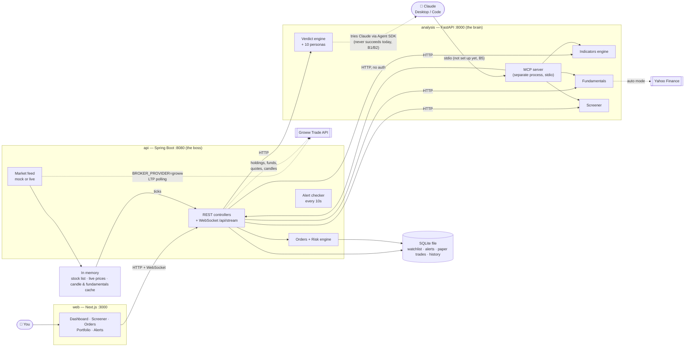

**In plain words**

- The **browser only talks to the api**, never to Python or the broker directly.
- The **api asks Python** to do any maths. It **saves only what the app owns** (watchlist, alerts, paper trades, history) in one **SQLite file**; everything the broker owns is fetched live and cached briefly **in memory**.
- **Prices** go: feed → in-memory price map → WebSocket → browser (no Redis).
- **Claude** can connect in two ways. Neither works end-to-end yet (see §5.6 and §5.7):
  1. The analysis service calls Claude itself through the Agent SDK.
  2. Claude (Desktop/Code) calls our **MCP server** tools.

---

## 4. What happens when the app starts

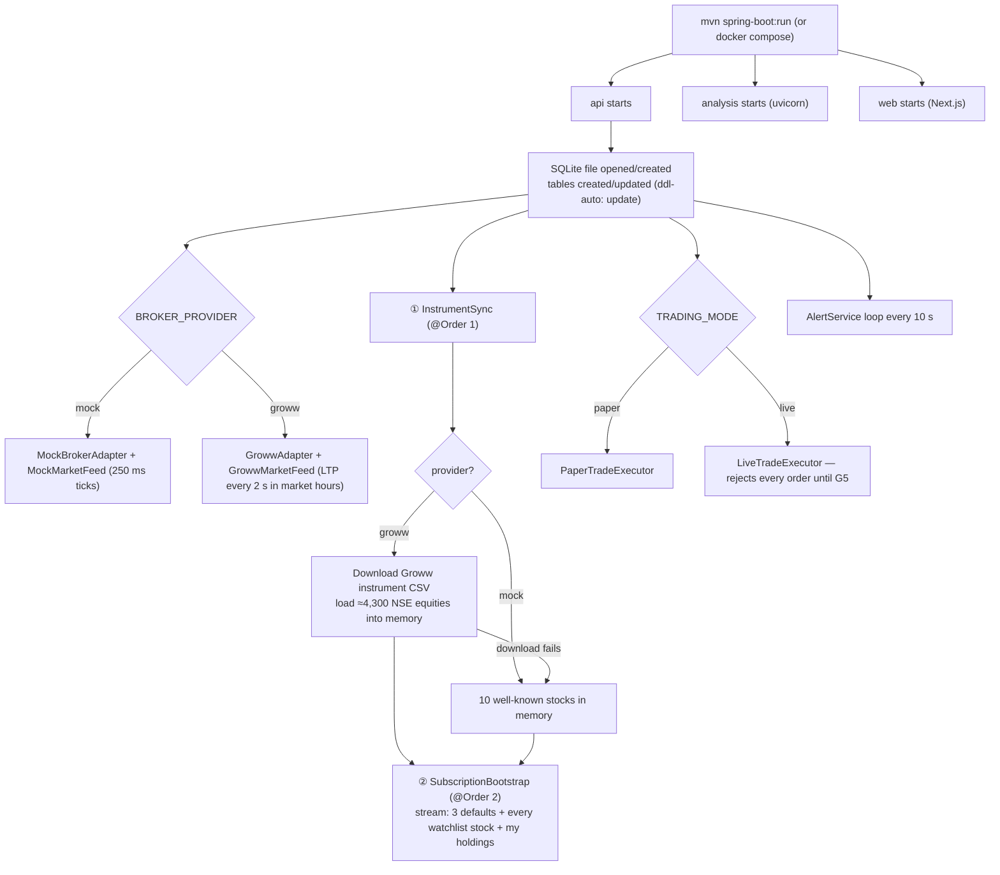

| Step | Code |
|---|---|
| Spring Boot entry, scheduling on | [ApiApplication.java:18](../apps/api/src/main/java/com/easetrading/api/ApiApplication.java#L18) |
| ① Stock list sync (Groww CSV or 10-stock seed) | [InstrumentSync.java:56](../apps/api/src/main/java/com/easetrading/api/instrument/InstrumentSync.java#L56) |
| ② Decide what streams (runs after ①, fixes B7) | [SubscriptionBootstrap.java:40](../apps/api/src/main/java/com/easetrading/api/marketdata/SubscriptionBootstrap.java#L40) |
| Broker chosen by `easetrading.broker.provider` | [MockBrokerAdapter.java:26](../apps/api/src/main/java/com/easetrading/api/broker/mock/MockBrokerAdapter.java#L26), [GrowwAdapter.java:26](../apps/api/src/main/java/com/easetrading/api/broker/groww/GrowwAdapter.java#L26) |
| Executor chosen by `easetrading.trading.mode` (live = blocked) | [PaperTradeExecutor.java:18](../apps/api/src/main/java/com/easetrading/api/order/PaperTradeExecutor.java#L18), [LiveTradeExecutor.java:17](../apps/api/src/main/java/com/easetrading/api/order/LiveTradeExecutor.java#L18) |
| Stock list held in memory (search, lookups) | [InstrumentStore.java](../apps/api/src/main/java/com/easetrading/api/instrument/InstrumentStore.java) |
| Database = one SQLite file (`DB_PATH`, default `apps/api/easetrading.db`) | [application.yml](../apps/api/src/main/resources/application.yml) |

---

## 5. Flow by flow

Each flow has a diagram, a step table with exact code locations, and its known gaps.

### 5.1 Live prices

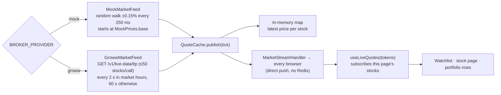

| Step | What happens | Code |
|---|---|---|
| 1 | Mock feed: fake price per streamed stock | [MockMarketFeed.java:37](../apps/api/src/main/java/com/easetrading/api/marketdata/MockMarketFeed.java#L37) |
| 1′ | Groww feed: batched LTP, paced by the rate limiter, only in market hours | [GrowwMarketFeed.java:43](../apps/api/src/main/java/com/easetrading/api/marketdata/GrowwMarketFeed.java#L43), [MarketHours.java](../apps/api/src/main/java/com/easetrading/api/marketdata/MarketHours.java) |
| 2 | Kept in memory + pushed to listeners (Java-time-aware JSON — B22) | [QuoteCache.java:34](../apps/api/src/main/java/com/easetrading/api/marketdata/QuoteCache.java#L34) |
| 3 | WebSocket forwards to all browsers (thread-safe session wrappers) | [MarketStreamHandler.java](../apps/api/src/main/java/com/easetrading/api/stream/MarketStreamHandler.java) |
| 4 | Each page subscribes the stocks it shows; re-subscribes after reconnect | [useLiveQuotes.ts:17](../apps/web/hooks/useLiveQuotes.ts#L17) |

**What streams:** 3 defaults, plus every watchlist stock, plus your holdings, plus any stock page you open.

**Gaps**
- Groww's true real-time stream only works through its Python SDK. We poll instead, which is fine for a personal dashboard. A streaming bridge is phase G6.
- Exchange holidays aren't modelled; on a holiday the feed just polls unchanged prices.
- Every browser still receives every tick.

### 5.2 Chart history (candles)

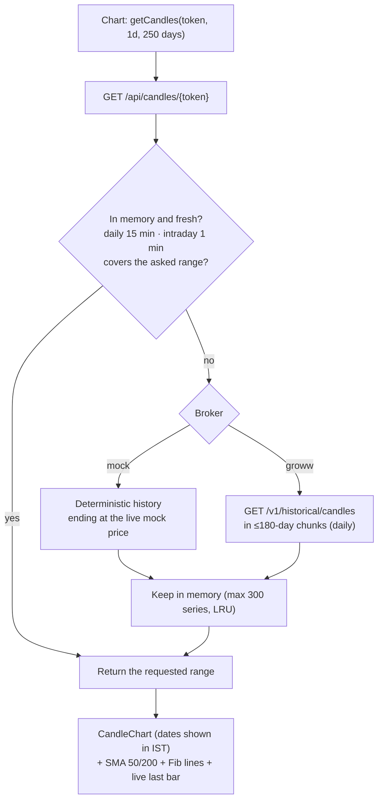

| Step | Code |
|---|---|
| In-memory candle cache (no DB table; the broker already stores history) | [CandleService.java](../apps/api/src/main/java/com/easetrading/api/marketdata/CandleService.java) |
| Groww candles, chunking, interval mapping | [GrowwAdapter.java:126](../apps/api/src/main/java/com/easetrading/api/broker/groww/GrowwAdapter.java#L126) |
| Mock history (fixes B8) | [MockBrokerAdapter.java:107](../apps/api/src/main/java/com/easetrading/api/broker/mock/MockBrokerAdapter.java#L107) |
| Chart, IST date fix | [CandleChart.tsx](../apps/web/components/CandleChart.tsx) |

### 5.3 Technical indicators

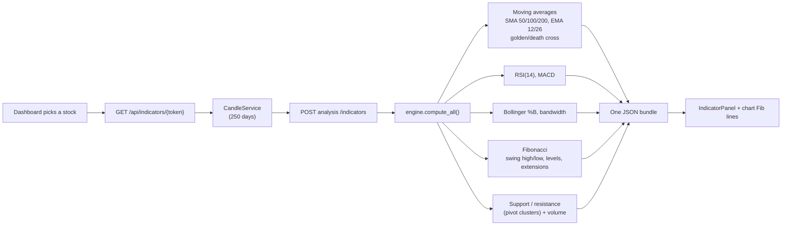

| Piece | Code |
|---|---|
| Java endpoint | [IndicatorController.java:34](../apps/api/src/main/java/com/easetrading/api/indicator/IndicatorController.java#L34) |
| Python entry | [main.py:29](../apps/analysis/main.py#L29) → [engine.py:36](../apps/analysis/indicators/engine.py#L36) |
| Each formula | [moving_averages.py](../apps/analysis/indicators/moving_averages.py), [oscillators.py](../apps/analysis/indicators/oscillators.py), [bands.py](../apps/analysis/indicators/bands.py), [fibonacci.py](../apps/analysis/indicators/fibonacci.py), [support_resistance.py](../apps/analysis/indicators/support_resistance.py) |

**Note.** The chart asks for 250 calendar days, which is about 170 trading days in live mode. That isn't enough for SMA-200, so it shows "—". Mock mode creates one candle per calendar day, so the problem stays hidden there.

### 5.4 Fundamentals

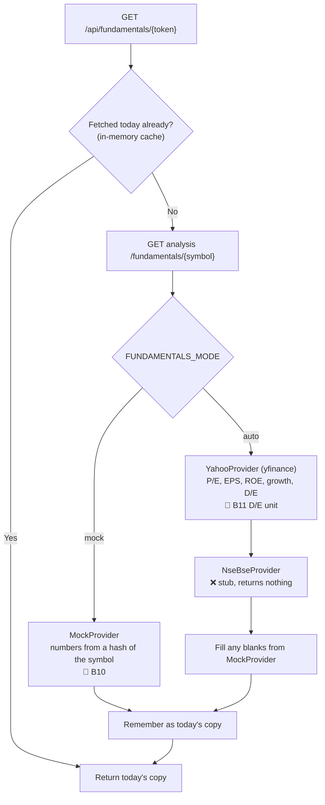

| Step | Code |
|---|---|
| Cache-per-day logic (in memory) | [FundamentalService.java](../apps/api/src/main/java/com/easetrading/api/fundamental/FundamentalService.java) |
| Mode switch | [fundamentals/service.py:22](../apps/analysis/fundamentals/service.py#L22) |
| Providers | [providers.py](../apps/analysis/fundamentals/providers.py) |

⚠ In `auto` mode, any missing real value is **quietly replaced with a fake mock value**, and the response's `source` still says `YAHOO`. A screener result can therefore rest on invented FII/DII numbers. Until the NSE/BSE fetch exists, this applies to FII/DII on every stock.

### 5.5 Screener

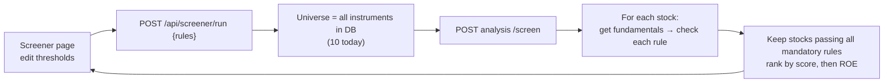

Default rules: P/E < 30 · ROE > 25% · EPS > 0 · FII > 5% · DII > 5% · profit growth > 0 · (optional) D/E < 1.

| Piece | Code |
|---|---|
| Java endpoint | [ScreenerController.java:34](../apps/api/src/main/java/com/easetrading/api/screener/ScreenerController.java#L34) |
| Rules | [rules.py:22](../apps/analysis/screener/rules.py#L22) |
| Loop + ranking | [screener/service.py:13](../apps/analysis/screener/service.py#L13) |

**Gap.** Stocks are screened one at a time, each with a live Yahoo call in `auto` mode. Once the full symbol master (thousands of stocks) is loaded, this will be very slow.

### 5.6 AI analysis (the verdict)

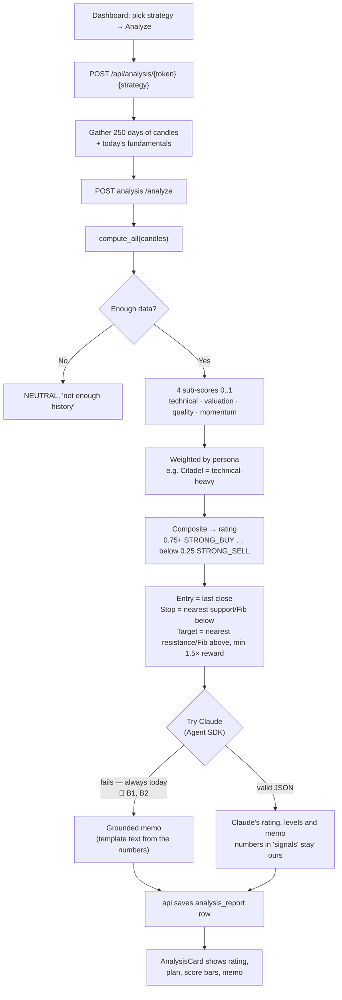

| Step | Code |
|---|---|
| Java orchestration + save | [AnalysisService.java:47](../apps/api/src/main/java/com/easetrading/api/analysis/AnalysisService.java#L47) |
| Python orchestration | [strategies/service.py:22](../apps/analysis/strategies/service.py#L22) |
| Scores, rating, trade levels | [verdict.py:179](../apps/analysis/strategies/verdict.py#L179), [verdict.py:116](../apps/analysis/strategies/verdict.py#L116) |
| 10 personas + weights | [personas.py:19](../apps/analysis/strategies/personas.py#L19) |
| Prompt sent to Claude | [prompt_builder.py](../apps/analysis/strategies/prompt_builder.py) |
| Claude call | [claude_runner.py:32](../apps/analysis/strategies/claude_runner.py#L32) |
| Fallback memo | [memo.py:14](../apps/analysis/strategies/memo.py#L14) |

**Gaps**

- 🐞 B1/B2: the Claude path never succeeds, so every verdict today is the grounded template.
- The Docker image installs only `requirements.txt` ([Dockerfile:4](../apps/analysis/Dockerfile#L4)), never the AI extras. The Agent SDK also needs a logged-in Claude on the same machine, which a cloud container doesn't have.
- When Claude *does* answer, its entry/stop/target are accepted as long as they're present. Nothing checks they're sensible, for example that the stop is below entry on a BUY ([verdict.py:214](../apps/analysis/strategies/verdict.py#L214)).
- Verdicts are saved with no `userId` and aren't cached, so each click recomputes from scratch.

### 5.7 MCP server — connecting Claude

This is the core goal of the project. The intent is:

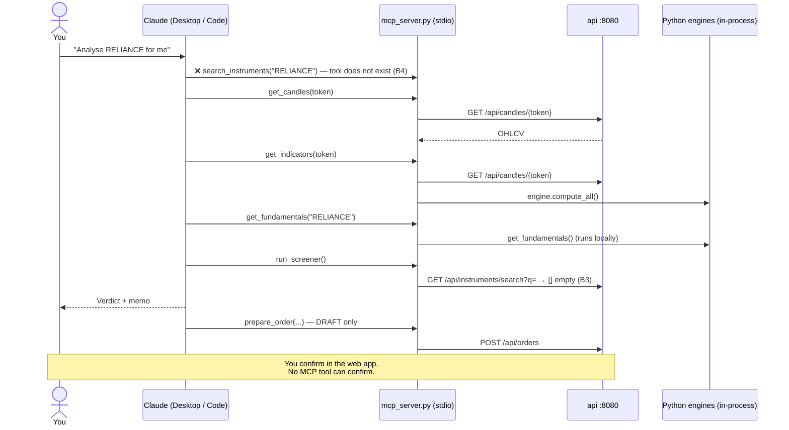

**Tools that exist today** ([mcp_server.py](../apps/analysis/mcp_server.py))

| Tool | Input | Calls | Works? |
|---|---|---|---|
| `get_quote` | token | `GET /api/quotes/{token}` | ✅ |
| `get_candles` | token, interval, days | `GET /api/candles/{token}` | ✅ |
| `get_fundamentals` | **symbol** | local Python | ✅ but runs its *own* mode (`FUNDAMENTALS_MODE` of the MCP process) and skips the api's daily cache |
| `get_indicators` | token | candles from api, maths locally | ✅ |
| `run_screener` | rules | `GET /api/instruments/search?q=` | ❌ B3: always scans 0 stocks |
| `get_portfolio` | — | `GET /api/portfolio` | ✅ (dev user) |
| `prepare_order` | token, side, type, qty, price | `POST /api/orders` | ✅ draft only. Not in the Agent SDK allow-list, but Desktop/Code would offer it. |

**What's missing for "connect via Claude easily"**

1. 🐞 B5: the server isn't registered in Claude Desktop (`claude_desktop_config.json`) or Claude Code (`.mcp.json`), and there's no setup guide.
2. 🐞 B4: there's no way to turn "RELIANCE" into its token `2885`. Most tools need the token, so Claude gets stuck at step one.
3. There's no `analyze(token, strategy)` tool, so Claude can't ask for the platform's own grounded verdict or persona view.
4. The MCP server calls the api **without any auth**. That works only because every endpoint is open (🐞 B6). Once auth is added, the MCP server needs a service token.
5. The LLD plans a separate `apps/mcp-server`. Today it lives inside `apps/analysis` and imports its modules directly.

### 5.8 Placing an order

The two-step safety flow:

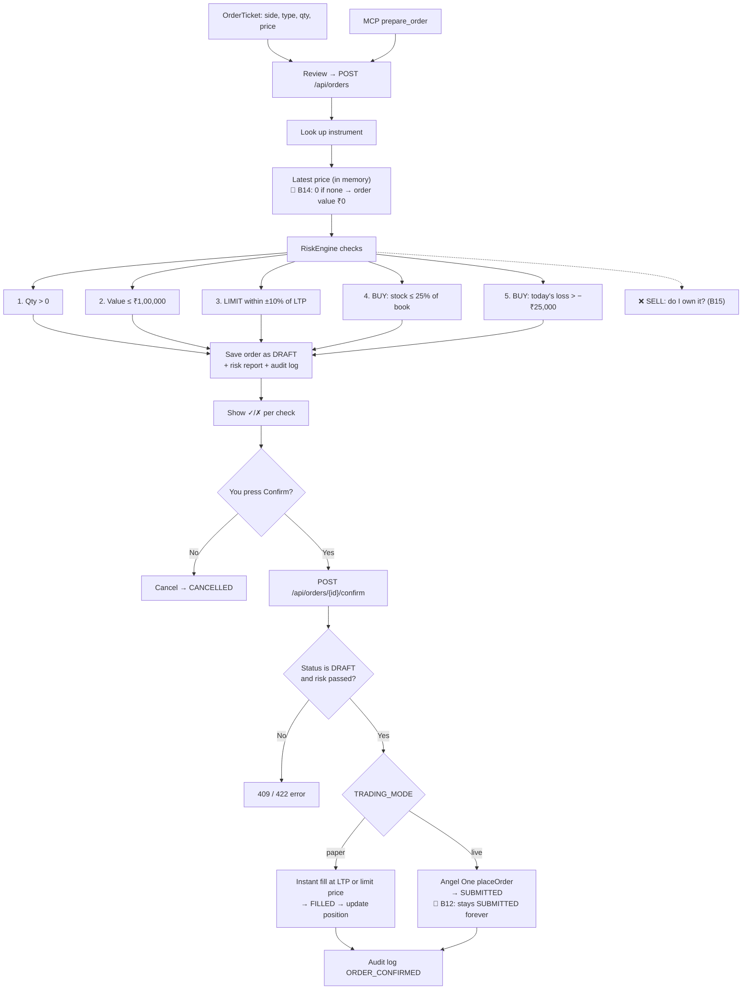

| Step | Code |
|---|---|
| Endpoints (no one-shot "place" endpoint, by design) | [OrderController.java:41](../apps/api/src/main/java/com/easetrading/api/order/OrderController.java#L41) |
| Create draft | [OrderService.java:62](../apps/api/src/main/java/com/easetrading/api/order/OrderService.java#L62) |
| Risk checks | [RiskEngine.java:37](../apps/api/src/main/java/com/easetrading/api/order/RiskEngine.java#L37) |
| Confirm + guards | [OrderService.java:84](../apps/api/src/main/java/com/easetrading/api/order/OrderService.java#L84) |
| Paper fill | [PaperTradeExecutor.java:26](../apps/api/src/main/java/com/easetrading/api/order/PaperTradeExecutor.java#L26) |
| Live send | [LiveTradeExecutor.java:36](../apps/api/src/main/java/com/easetrading/api/order/LiveTradeExecutor.java#L36), [AngelOneClient.java:131](../apps/api/src/main/java/com/easetrading/api/broker/AngelOneClient.java#L131) |
| Position maths | [Position.java:41](../apps/api/src/main/java/com/easetrading/api/position/Position.java#L41) |
| UI ticket | [OrderTicket.tsx:26](../apps/web/components/OrderTicket.tsx#L26) |

**Note.** The "only a human can confirm" rule is enforced **only by the UI and by the MCP server not having a confirm tool**. The api itself can't tell a human from a script. Anything that can reach `/api/orders/{id}/confirm` can confirm (🐞 B6).

### 5.9 Portfolio

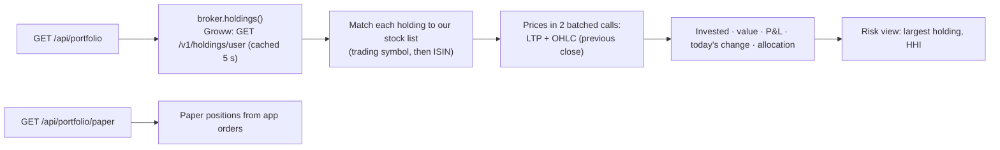

| Piece | Code |
|---|---|
| Real portfolio | [BrokerPortfolioService.java:56](../apps/api/src/main/java/com/easetrading/api/portfolio/BrokerPortfolioService.java#L56) |
| Holding → stock matching | [InstrumentResolver.java](../apps/api/src/main/java/com/easetrading/api/instrument/InstrumentResolver.java) |
| Endpoints (`/api/portfolio`, `/positions`, `/paper`) | [PortfolioController.java](../apps/api/src/main/java/com/easetrading/api/position/PortfolioController.java) |
| Page with "My Portfolio" / "Paper trades" tabs | [portfolio/page.tsx](../apps/web/app/portfolio/page.tsx) |

**No price = no fake P&L (B24 fix).** A holding with no live price comes back with `priceAvailable: false`: its LTP and P&L are null, its value is shown *at cost* (so allocation still adds up), and totals count only priced holdings (`pricedHoldings`). The UI says "Price unavailable" and shows "—" for returns.

**UI (2026-11-24 redesign):** current-value summary at the top with invested, total and today's returns · allocation as a segmented bar (top 5 + "Other", validated colour-blind-safe dark palette) · holdings as a sortable table on desktop and cards on phones · concentration meter with a 25% line · "Paper trades" tab. Components: [AllocationBar.tsx](../apps/web/components/portfolio/AllocationBar.tsx), [HoldingsList.tsx](../apps/web/components/portfolio/HoldingsList.tsx).

⏳ **To verify once market data is available:** is Groww's OHLC `close` the *previous* day's close (needed for "today's P&L")? If not, switch to the quote's `day_change`.

### 5.9b Dashboard, Stocks and Watchlist (new)

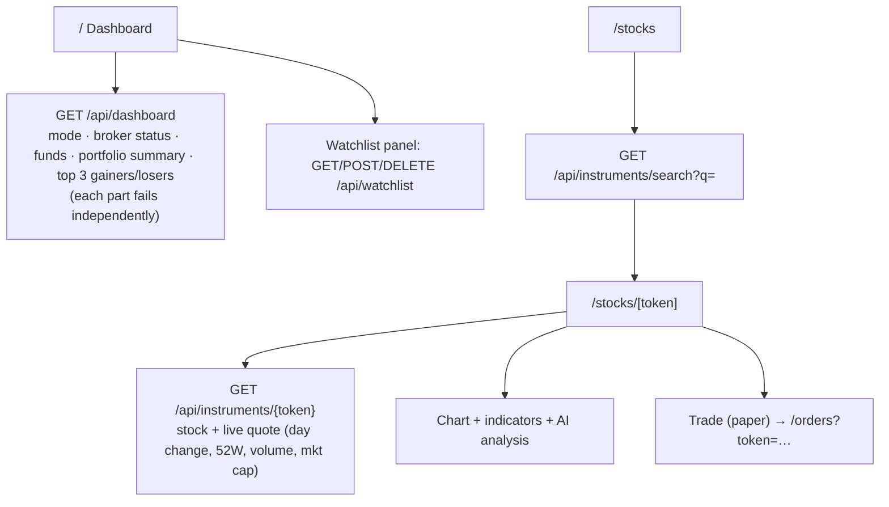

| Piece | Code |
|---|---|
| Dashboard endpoint | [DashboardController.java](../apps/api/src/main/java/com/easetrading/api/dashboard/DashboardController.java) |
| Watchlist (new user gets RELIANCE, TCS, HDFCBANK) | [WatchlistService.java](../apps/api/src/main/java/com/easetrading/api/watchlist/WatchlistService.java) |
| Stock detail + search | [InstrumentController.java](../apps/api/src/main/java/com/easetrading/api/instrument/InstrumentController.java) |
| Pages | [page.tsx](../apps/web/app/page.tsx), [stocks/page.tsx](../apps/web/app/stocks/page.tsx), [stocks/[token]/page.tsx](../apps/web/app/stocks/[token]/page.tsx) |

### 5.10 Alerts

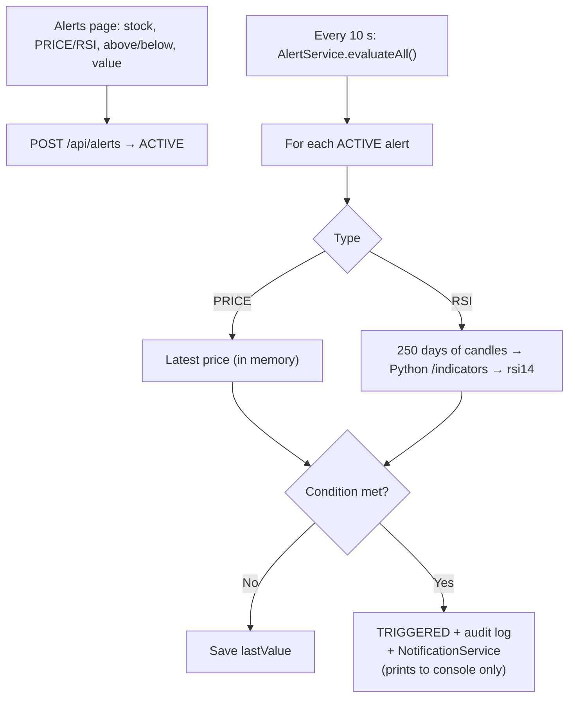

Code: [AlertService.java:70](../apps/api/src/main/java/com/easetrading/api/alert/AlertService.java#L70), [NotificationService.java:15](../apps/api/src/main/java/com/easetrading/api/alert/NotificationService.java#L15).

**Gaps**

- No email or push notifications.
- Alerts fire once and never re-arm.
- Each RSI alert makes an HTTP call to Python every 10 seconds; with many alerts, cache the indicators instead.
- 🐞 B17.

### 5.11 Login, users and broker connection

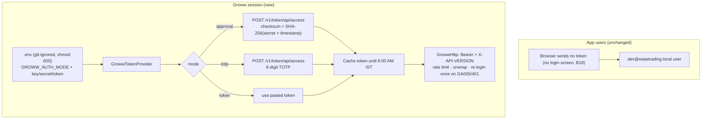

| Piece | Code |
|---|---|
| Token modes, expiry, throttled retries (150/day limit) | [GrowwTokenProvider.java](../apps/api/src/main/java/com/easetrading/api/broker/groww/GrowwTokenProvider.java) |
| Every Groww call | [GrowwHttp.java](../apps/api/src/main/java/com/easetrading/api/broker/groww/GrowwHttp.java), [GrowwRateLimiter.java](../apps/api/src/main/java/com/easetrading/api/broker/groww/GrowwRateLimiter.java) |
| `/api/broker/status`, `/profile`, `/funds` (credentials never go over HTTP) | [BrokerController.java](../apps/api/src/main/java/com/easetrading/api/broker/BrokerController.java) |

## 6. Issues found

Severity: 🔴 must fix before using live money or a public URL · 🟠 breaks a feature · 🟡 wrong or odd result · ⚪ minor.
When fixed, change the Status to ✅ and add the commit.

| ID | Sev | Area | Problem (plain words) | Where | Status |
|---|---|---|---|---|---|
| B1 | 🟠 | AI | The Agent SDK call never attaches the MCP server (no `mcp_servers` option). The allowed tool names are also in the wrong format: the SDK expects `mcp__<server>__<tool>`. Claude gets no tools. | [claude_runner.py:50](../apps/analysis/strategies/claude_runner.py#L50) | Open |
| B2 | 🟠 | AI | The reply-reading loop looks for a plain-text `text`/`content` field. The SDK sends content as a list of blocks, and the final text lives in `ResultMessage.result`. So the collected text is always empty and it always falls back. *(Based on the SDK's message types; confirm with one live run.)* | [claude_runner.py:60](../apps/analysis/strategies/claude_runner.py#L60) | Open |
| B3 | 🟠 | MCP | `run_screener` builds its stock list from `/api/instruments/search?q=`. The api returns an **empty list** for a blank search, so the screen covers 0 stocks. Use `POST /api/screener/run` instead. | [mcp_server.py:75](../apps/analysis/mcp_server.py#L75), [InstrumentController.java:26](../apps/api/src/main/java/com/easetrading/api/instrument/InstrumentController.java#L26) | Open |
| B4 | 🟠 | MCP | No tool turns a stock name into its token, yet most tools need the token. | [mcp_server.py](../apps/analysis/mcp_server.py) | Open |
| B5 | 🟠 | MCP | The MCP server isn't registered in Claude Desktop or Claude Code, has no run guide, and its packages (`mcp`, `httpx`) aren't in the Docker image. | — | Open |
| B6 | 🔴 | Security | `/api/orders/**`, `/api/portfolio/**` and `/api/alerts/**` are open to everyone (`permitAll`) and fall back to the dev user. On the public Render URL, anyone could create **and confirm** orders, which means real money if `TRADING_MODE=live`. CORS also trusts every `*.vercel.app` site with credentials, and the WebSocket accepts any origin. | [SecurityConfig.java:52](../apps/api/src/main/java/com/easetrading/api/config/SecurityConfig.java#L52), [SecurityConfig.java:37](../apps/api/src/main/java/com/easetrading/api/config/SecurityConfig.java#L37), [WebSocketConfig.java:26](../apps/api/src/main/java/com/easetrading/api/config/WebSocketConfig.java#L26) | Open |
| B7 | 🟠 | Prices | On a brand-new DB the default 3 stocks are subscribed *before* the stocks are seeded, so nothing streams until a restart. This hits the first Render deploy. | [MarketSubscription.java:31](../apps/api/src/main/java/com/easetrading/api/marketdata/MarketSubscription.java#L31), [SymbolMasterSeeder.java:29](../apps/api/src/main/java/com/easetrading/api/instrument/SymbolMasterSeeder.java#L29) | ✅ Fixed (G1–G3, uncommitted) |
| B8 | ⚪ | Chart (mock) | Fake history starts at a random ₹1000–3500 but live ticks start at fixed prices (e.g. RELIANCE ₹1420), so the last candle jumps with a huge wick. | [CandleService.java:82](../apps/api/src/main/java/com/easetrading/api/marketdata/CandleService.java#L82), [MockMarketFeed.java:53](../apps/api/src/main/java/com/easetrading/api/marketdata/MockMarketFeed.java#L53) | ✅ Fixed (G1–G3, uncommitted) |
| B9 | 🟠 | Candles | Once any candles exist for a stock, no newer candles are ever fetched. In live mode the chart and every indicator freeze on the first day's data. Asking for more days than the first fetch also returns less. | [CandleService.java:49](../apps/api/src/main/java/com/easetrading/api/marketdata/CandleService.java#L49) | ✅ Fixed (G1–G3, uncommitted) |
| B10 | 🟡 | Fundamentals (mock) | The fake-number seed is shifted only once, so every field sits at the same % of its range. A stock is "good at everything" or "bad at everything", which skews screener and verdict tests. | [providers.py:84](../apps/analysis/fundamentals/providers.py#L84) | Open |
| B11 | 🟡 | Fundamentals (auto) | Yahoo's `debtToEquity` is a **percentage** (45 means 0.45×). The rules treat it as a ratio (`< 1`, `> 2`), so almost every real stock fails D/E and loses quality points. | [providers.py:55](../apps/analysis/fundamentals/providers.py#L55), [rules.py:32](../apps/analysis/screener/rules.py#L32), [verdict.py:87](../apps/analysis/strategies/verdict.py#L87) | Open |
| B12 | 🔴 | Live orders | Live orders stop at `SUBMITTED`; nothing checks Angel One for the fill. Positions and P&L never update, and the daily-loss check sees no losses. | [LiveTradeExecutor.java:42](../apps/api/src/main/java/com/easetrading/api/order/LiveTradeExecutor.java#L42) | Open — live orders blocked until G5 |
| B13 | 🟠 | Orders | Risk is checked only when the draft is made. A draft can be confirmed hours later at a very different price, and drafts never expire. | [OrderService.java:84](../apps/api/src/main/java/com/easetrading/api/order/OrderService.java#L84) | Open |
| B14 | 🟠 | Orders | A MARKET order with no live price gets price 0. The order value is then ₹0 and passes the max-value check, and a paper fill happens at ₹0. | [OrderService.java:68](../apps/api/src/main/java/com/easetrading/api/order/OrderService.java#L68), [PaperTradeExecutor.java:27](../apps/api/src/main/java/com/easetrading/api/order/PaperTradeExecutor.java#L27) | Open |
| B15 | 🟡 | Orders | SELL orders skip the concentration and daily-loss checks, and nothing checks you own the shares. | [RiskEngine.java:62](../apps/api/src/main/java/com/easetrading/api/order/RiskEngine.java#L62) | Open |
| B16 | 🟡 | Broker | Re-connecting keeps the *old* credentials (the `orElse` returns the existing row unchanged). Saved credentials are never used anyway, because login always reads `.env`. | [BrokerController.java:42](../apps/api/src/main/java/com/easetrading/api/broker/BrokerController.java#L42), [AngelOneClient.java:47](../apps/api/src/main/java/com/easetrading/api/broker/AngelOneClient.java#L47) | ✅ Obsolete — Angel One connect endpoint removed |
| B17 | ⚪ | Alerts | Deleting an alert doesn't check that it's yours. | [AlertService.java:63](../apps/api/src/main/java/com/easetrading/api/alert/AlertService.java#L63) | Open |
| B18 | 🟡 | Web | There's no login screen and no token is sent. The header always says "Paper trading", even in live mode. | [api.ts:15](../apps/web/lib/api.ts#L15), [Header.tsx:22](../apps/web/components/Header.tsx#L22) | 🟡 Header fixed; login screen still open |
| B19 | ⚪ | Web | Watchlist and order/alert stock pickers are hard-coded to 3 stocks. The search API exists but no screen uses it. | [page.tsx:17](../apps/web/app/page.tsx#L17), [orders/page.tsx:10](../apps/web/app/orders/page.tsx#L10), [alerts/page.tsx:8](../apps/web/app/alerts/page.tsx#L8) | ✅ Fixed (G1–G3, uncommitted) |
| B20 | ⚪ | DB | Candles are meant to live in a TimescaleDB hypertable, but nothing ever runs `create_hypertable`, so it's a plain table. Schema is managed by `ddl-auto: update` with no Flyway migrations. | [application.yml:21](../apps/api/src/main/resources/application.yml#L21) | ✅ Obsolete — candles are no longer stored (SQLite, in-memory cache) |
| B22 | 🟠 | Prices | `QuoteCache` used a plain Jackson mapper that can't write `Instant`, so every tick publish failed ("Failed to publish tick") — live prices likely never reached the browser, and market orders drafted with ₹0 (see B14). | [QuoteCache.java:25](../apps/api/src/main/java/com/easetrading/api/marketdata/QuoteCache.java#L25) | ✅ Fixed (G1–G3, uncommitted) |
| B23 | 🟡 | Prices | Redis `quote:{token}` isn't separated by data source, so demo prices (kept 24 h) showed as real after switching `BROKER_PROVIDER` from mock to groww. Cache was cleared by hand; needs a source-specific key. | [QuoteCache.java:34](../apps/api/src/main/java/com/easetrading/api/marketdata/QuoteCache.java#L34) | ✅ Fixed — prices live in memory and reset on restart; Redis removed |
| B24 | 🟠 | Portfolio | When no price is available (e.g. Groww 403 on the free plan), LTP falls back to the average cost, so P&L shows ₹0.00 — looks real but isn't. Should say "price unavailable". | [BrokerPortfolioService.java](../apps/api/src/main/java/com/easetrading/api/portfolio/BrokerPortfolioService.java) | ✅ Fixed — `priceAvailable` / `pricedHoldings`; UI shows "Price unavailable" and "—" |
| B21 | ⚪ | Config | Config smells: (fixed) `DB_URL` pointed at the docker host `postgres` — gone with SQLite; docker compose read `.env` from `infra/` (it lives at the repo root — now pass `--env-file ../.env`); and the Maven/npm Dockerfiles turn off TLS checks ([api Dockerfile:12](../apps/api/Dockerfile#L12), [web Dockerfile:9](../apps/web/Dockerfile#L9)). | — | Open |

---

## 7. What's left to build (roadmap)

> **Direction change (2026-11-24):** Angel One is being replaced by **Groww**, and the work order is now **basics first** (stock list, real portfolio, personal dashboard). Analysis, AI and MCP come after. The active plan is [GROWW_INTEGRATION_PLAN.md](GROWW_INTEGRATION_PLAN.md) (phases G0–G6). Phases A–D below still apply, but come after G3.

Ordered by what unlocks the main goal (Claude + MCP) first, then safety, then features from the HLD/LLD.

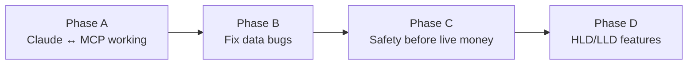

### Phase A — Claude ↔ MCP working (the core goal)

| # | Task | Fixes |
|---|---|---|
| A1 | Add a `search_instruments(query)` tool | B4 |
| A2 | Point `run_screener` at `POST /api/screener/run` | B3 |
| A3 | Add an `analyze(token, strategy)` tool that returns the platform verdict | — |
| A4 | Make `get_fundamentals` go through the api (`/api/fundamentals/{token}`) so it uses the same mode and cache | — |
| A5 | Write the setup guide and register the server in Claude Desktop / Claude Code (`.mcp.json`), with a local venv holding `requirements-ai.txt` | B5 |
| A6 | **Decide:** keep the backend calling Claude (Agent SDK, fix B1/B2), **or** make Claude Desktop/Code the place where analysis happens (MCP only, simpler). | B1, B2 |

### Phase B — Fix data bugs

B7 (startup order), B9 (refresh candles), B14 (₹0 market orders), B10, B11, B8.

### Phase C — Safety before live money or a public URL

| # | Task | Fixes |
|---|---|---|
| C1 | Require a login on orders/portfolio/alerts; remove the dev-user fallback outside local dev | B6 |
| C2 | Login screen; send the JWT from the web app; show the real trading mode in the header | B18 |
| C3 | Give the MCP server a service token with a "can draft, can't confirm" role | B6 |
| C4 | Re-run risk at confirm time; expire drafts (e.g. after 2 minutes); add an idempotency key | B13 |
| C5 | Holdings check on SELL | B15 |
| C6 | Poll Angel One order status → FILLED/REJECTED → update positions | B12 |
| C7 | Tighten CORS and WebSocket origins | B6 |

### Phase D — Features from the HLD/LLD not built yet

- [x] User watchlists (`watchlist_item` table, UI, search box) — B19 (G2)
- [x] Daily symbol-master sync from Groww (NSE equities) (G2)
- [ ] Real tick-by-tick prices (Groww Python-SDK streaming bridge, G6)
- [ ] NSE/BSE shareholding fetch (real FII/DII/promoter %), plus promoter pledge %
- [ ] Email / push notifications; more alert types (MACD cross, signal)
- [ ] SL / SL-M order types, INTRADAY product, modify order
- [x] Real holdings/positions from Groww (G3, read-only)
- [ ] In-memory caches for indicators and verdicts (no Redis needed)
- [ ] Multi-timeframe trend (daily/weekly/monthly) in the verdict
- [ ] Per-user broker credentials (today: one account from `.env`)
- [ ] Flyway migrations for the SQLite schema (when the schema settles)
- [ ] Separate `apps/mcp-server` and shared types package (per LLD)
- [ ] Run and add to the test suites (MCP tools, OrderService, CandleService)

---

## 8. Reference

### 8.1 Where data lives

**SQLite file** (`DB_PATH`, default `apps/api/easetrading.db`, git-ignored) — only what the app itself owns:

| Table | Holds | Entity |
|---|---|---|
| `users` | email, BCrypt hash, role | [User.java](../apps/api/src/main/java/com/easetrading/api/user/User.java) |
| `watchlist_item` | my watchlist (user, token, order) | [WatchlistItem.java](../apps/api/src/main/java/com/easetrading/api/watchlist/WatchlistItem.java) |
| `alert` | price/RSI alerts | [Alert.java](../apps/api/src/main/java/com/easetrading/api/alert/Alert.java) |
| `orders` | paper orders + risk report | [Order.java](../apps/api/src/main/java/com/easetrading/api/order/Order.java) |
| `position` | paper holdings (qty, avg price) | [Position.java](../apps/api/src/main/java/com/easetrading/api/position/Position.java) |
| `analysis_report` | every verdict shown | [AnalysisReport.java](../apps/api/src/main/java/com/easetrading/api/analysis/AnalysisReport.java) |
| `audit_log` | ORDER_DRAFTED / CONFIRMED / CANCELLED, ALERT_TRIGGERED | [AuditLog.java](../apps/api/src/main/java/com/easetrading/api/audit/AuditLog.java) |

**In memory** (rebuilt automatically, nothing to back up):

| What | Refreshed | Code |
|---|---|---|
| Stock list (≈4,300 NSE equities) | startup + weekdays 8:30 AM IST | [InstrumentStore.java](../apps/api/src/main/java/com/easetrading/api/instrument/InstrumentStore.java) |
| Latest price per stock | every tick | [QuoteCache.java](../apps/api/src/main/java/com/easetrading/api/marketdata/QuoteCache.java) |
| Candles | 15 min (daily) / 1 min (intraday), max 300 series | [CandleService.java](../apps/api/src/main/java/com/easetrading/api/marketdata/CandleService.java) |
| Fundamentals | once per stock per day | [FundamentalService.java](../apps/api/src/main/java/com/easetrading/api/fundamental/FundamentalService.java) |

**At the broker (Groww), fetched live:** holdings, positions, funds, profile, prices, history.

### 8.2 Config switches (all default to safe)

| Env var | Default | Effect |
|---|---|---|
| `BROKER_PROVIDER` | `mock` | `groww` = your real Groww account (read-only) |
| `GROWW_AUTH_MODE` | `approval` | `approval` (key + secret) · `totp` · `token` |
| `GROWW_API_KEY` / `GROWW_API_SECRET` / `GROWW_TOTP_SECRET` / `GROWW_ACCESS_TOKEN` | empty | Only in `.env`; single-quote values |
| `DB_PATH` | `easetrading.db` | Where the SQLite file lives (Docker: `/app/data/easetrading.db`) |
| `FUNDAMENTALS_MODE` | `mock` | `auto` = Yahoo + mock backfill |
| `TRADING_MODE` | `paper` | `live` = **blocked** until G5 |
| `RISK_MAX_ORDER_VALUE` / `_POSITION_PCT` / `_DAILY_LOSS_LIMIT` / `_PRICE_BAND_PCT` | 100000 / 25 / 25000 / 10 | Risk engine limits |
| `JWT_SECRET`, `CREDENTIAL_AES_KEY` | dev values / blank | Blank AES key → a new random key on every start |
| `ANALYSIS_SERVICE_URL` | `http://localhost:8000` | Where the api finds Python |
| `API_BASE_URL` (MCP) | `http://api:8080` | Where the MCP server finds the api. Use `http://localhost:8080` when Claude runs it on your Mac. |
| `ANTHROPIC_API_KEY` | unset | Keep unset (otherwise billing moves to the paid API) |

### 8.3 All endpoints

**api (`:8080`)** — 🔓 = no login needed today

| Method | Path | 🔓 | Purpose |
|---|---|---|---|
| GET | `/api/health` | 🔓 | Liveness |
| POST | `/api/auth/register`, `/api/auth/login` | 🔓 | Get a JWT |
| GET | `/api/instruments/search?q=` | 🔓 | Stock search (blank `q` → empty) |
| GET | `/api/quotes/{token}` | 🔓 | Latest price |
| GET | `/api/candles/{token}?interval&days` | 🔓 | History |
| GET | `/api/indicators/{token}` | 🔓 | Indicator bundle |
| GET | `/api/fundamentals/{token}` | 🔓 | Fundamentals |
| POST | `/api/screener/run` | 🔓 | Screen |
| POST | `/api/analysis/{token}` | 🔓 | Verdict |
| GET/POST | `/api/orders` | 🔓 | List / create draft |
| POST | `/api/orders/{id}/confirm`, `/cancel` | 🔓 | Confirm / cancel |
| GET | `/api/portfolio` | 🔓 | **Real** holdings (Groww) + live P&L + risk |
| GET/POST/DELETE | `/api/alerts[/{id}]` | 🔓 | Alerts |
| GET | `/api/broker/status`, `/profile`, `/funds` | 🔓 | Broker account (read-only) |
| GET | `/api/dashboard`, `/api/dashboard/mode` | 🔓 | Home screen / header badge |
| GET | `/api/instruments/{token}` | 🔓 | Stock + live quote |
| GET/POST/DELETE | `/api/watchlist[/{token}]` | 🔓 | My watchlist |
| GET | `/api/portfolio/positions`, `/api/portfolio/paper` | 🔓 | Broker positions / paper holdings |
| WS | `/api/stream` | 🔓 | Live ticks |

**analysis (`:8000`):** `GET /health` · `POST /indicators` · `GET /fundamentals/{symbol}` · `POST /screen` · `GET /strategies` · `POST /analyze`

---

## 9. Changelog

Add one row per change, newest first.

| Date | Commit | Change | Sections touched |
|---|---|---|---|
| 2026-11-24 | uncommitted | **Simplified storage → SQLite.** Removed Postgres, Redis and Timescale. One SQLite file holds only app-owned data (users, watchlist, alerts, paper orders/positions, analysis history, audit log). Stock list, live prices, candles and fundamentals moved to in-memory caches; broker-credential table and AES service removed. No Docker needed to run. Verified: writes + restart persistence on SQLite, Groww mode works. B20 obsolete, B23 fixed. | §2, §3, §4, §5.1, §5.2, §5.4, §5.8, §5.10, §6, §7, §8 |
| 2026-11-24 | uncommitted | **UI pass.** New look across the app via theme tokens (navy surfaces, indigo accent, emerald/rose only for gains/losses, Inter font, sticky glass header with phone-scrollable nav). Portfolio page redesigned (summary, allocation bar, sortable holdings + phone cards, risk meter). Fixed B24 (no fake ₹0 P&L when prices are missing) on the api, Portfolio and Dashboard. | §2, §5.9, §6 |
| 2026-11-24 | uncommitted | **First real Groww run.** Working: login (approval mode), profile, funds, holdings, positions, 4,334-stock sync. Free plan blocks all market data (LTP, OHLC, quote, candles → 403). Logged B23, B24. No code change. | §2, §6 |
| 2026-11-24 | uncommitted | **Groww G1–G3.** Angel One removed. New broker layer (`BrokerAdapter`, Groww + mock), Groww auth/HTTP/rate-limit/mapper, instrument sync from Groww CSV, watchlists, real portfolio, dashboard/stocks/stock pages, live orders blocked. Fixed B7, B8, B9, B19, B22 (new), part of B18. Next.js → 14.2.35 (security patch). Ports bound to localhost. | §1, §2, §3, §4, §5.1, §5.2, §5.9, §5.9b, §5.11, §6, §7, §8 |
| 2026-11-24 | `1f8d7f1` | Decided to replace Angel One with Groww and build basics first. Added [GROWW_INTEGRATION_PLAN.md](GROWW_INTEGRATION_PLAN.md). No code changed yet. | §7 |
| 2026-11-24 | `1f8d7f1` | First full review; report created. 21 issues logged (B1–B21). | All |
